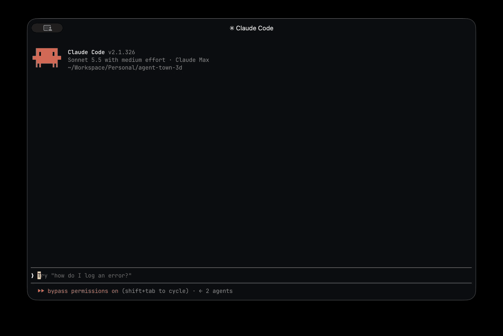

<h1 align="center">cc-huddle</h1>

<p align="center">
  <strong>Multi-agent orchestration for Claude Code.</strong><br>
  A Claude Code plugin that runs a team of Claude Code sessions on your repository, each member on the model you choose.
</p>

<p align="center">
  <a href="https://github.com/geezerrrr/cc-huddle/actions/workflows/ci.yml"></a>
  <a href="LICENSE"></a>
  
</p>

<p align="center">
  
</p>

> **Status: early (0.1).** The engine is tested against scripted model streams; long runs with real models are still few. Expect rough edges, and please [report them](https://github.com/geezerrrr/cc-huddle/issues).

## Why cc-huddle

Plenty of tools run Claude Code sessions in parallel. Most leave the process to someone: you start and merge each session yourself, or a lead model decides how many teammates to spawn, how to split the work and when it is done. cc-huddle puts the process in code. State machines decide what starts, what waits and what counts as done; the models only do the work.

|            | cc-huddle                                         | Agent Teams                           | Claude Squad, Conductor            |
| ---------- | ------------------------------------------------- | ------------------------------------- | ---------------------------------- |
| Who plans  | The members, in a meeting; you approve the plan   | The lead model                        | You                                |
| Isolation  | A git worktree per subtask                        | One shared working tree               | A worktree per session             |
| Done means | Reviewed by another member, then merged           | A teammate marks its task complete    | You review and merge each branch   |
| Models     | Any per member, any Anthropic-compatible provider | Per teammate, on the lead's provider  | Several agent CLIs                 |
| Runs as    | A Claude Code plugin, in your session             | Built into Claude Code (experimental) | A separate terminal or desktop app |

For one focused job, a single session or a subagent is cheaper and quicker. cc-huddle is for work with several parts and dependencies.

## How it works

<p align="center">
  
</p>

- **Meeting.** The members you pick discuss the task in turns, read-only. The host writes a plan of tasks with owners, dependencies and acceptance criteria; you approve it, change it or drop it.
- **Work.** Each subtask runs in its own worktree as a fresh Claude Code session, on its member's model, as soon as what it waits on is merged. Members can ask each other questions.
- **Review and merge.** Another member checks each delivery against its acceptance criteria and passes it or sends it back with notes. Passed work merges into `huddle/<goal>/main` one subtask at a time; a conflict goes back to its author.
- **You.** Plans to approve, finished tasks to accept, permission requests and members' questions come to you in Claude Code's dialog, or wait in the pane; your session's model can't answer them. A task you accept comes with what was done and how to check it. The goal branch is yours to merge: cc-huddle never pushes or touches your working tree.

The full design, state machines included, is [docs/design.md](docs/design.md).

## Install

Requirements: Claude Code 2.1.322 or later, Node.js 22.15 or later with npm on your `PATH`, and git. The plugin's MCP server installs its own dependencies with npm on its first start.

From GitHub, in a terminal:

```sh
claude plugin install cc-huddle --marketplace geezerrrr/cc-huddle
```

Or inside Claude Code:

```
/plugin marketplace add geezerrrr/cc-huddle
/plugin install cc-huddle@geezerrrr
```

From a local clone:

```sh
git clone https://github.com/geezerrrr/cc-huddle.git
claude plugin marketplace add ./cc-huddle
claude plugin install cc-huddle@geezerrrr
```

To try it without installing, start a session with the plugin loaded from the clone: `claude --plugin-dir ./cc-huddle/plugin`. The built plugin is committed, so there is nothing to build.

Restart Claude Code after installing. To update, `claude plugin update cc-huddle@geezerrrr`. To uninstall, `claude plugin uninstall cc-huddle@geezerrrr`: this removes the plugin's data folder with its worktrees and any work not yet delivered; work already merged stays on the `huddle/*` branches, and `--keep-data` keeps the folder.

## Set up a team

A team is a `team.yaml` listing the members, each with a role and the model it runs on. Put it in `~/.claude/huddle/` for all your repositories, or in a repository's `.claude/huddle/`:

```yaml
# ~/.claude/huddle/team.yaml
members:
  sonnet:
    role: developer
    model: sonnet
  opus:
    role: developer
    model: opus
```

A member without `env` runs on your own Claude Code sign-in. A member on another provider gets its variables, any that Claude Code reads:

```yaml
glm:
  role: designer
  model: glm-5.3-flashx
  env:
    ANTHROPIC_BASE_URL: https://open.bigmodel.cn/api/anthropic
    ANTHROPIC_AUTH_TOKEN: ${GLM_API_KEY}
```

`${VAR}` is filled in from your environment, so keys stay out of the files. A role's duties go in `roles/<role>.md`, Markdown every member in that role reads. Effort, permissions per member and for the whole team, and a provider's full setup: [docs/configuration.md](docs/configuration.md).

## Use it

Start Claude Code in a repository and hand the team a task:

```
/huddle build a two-player dice game, opus on the rules, sonnet on the UI
```

Your session proposes a meeting (who attends, what each brings), or one member for a job that needs no planning, and asks you to start; a job too small for a team it offers to do itself. The team then works in the background; your session stays free.

| You type                               | What happens                                                                   |
| -------------------------------------- | ------------------------------------------------------------------------------ |
| `/huddle <task>`                       | Hands the team a task                                                          |
| `/huddle`                              | Opens the pane: the meeting, the team, what needs you                          |
| `/huddle status`                       | Prints where the session's goal stands                                         |
| `/huddle pause`, `/huddle resume`      | Pauses the session's goal; resumes it, or takes up another of the repository's |
| `/huddle review on\|off`               | Turns review of deliveries on or off                                           |
| `/huddle meeting <size>`               | Sets how long meetings run: `small`, `discussion` or `large`                   |
| `@sonnet put the scoreboard top right` | Passes a member a message, in their session                                    |

You can also ask your session in words ("have opus do the scoreboard"). A session runs one goal; for more goals at once, run more sessions. Like `/model`, `review` and `meeting` apply to the session's goal and goals started after. The band above the prompt keeps count: `cc-huddle · meeting · 3 working · 1 needs you`. Closing the session pauses its goal; `/huddle resume` goes on where it stopped.

<table>
  <tr>
    <td width="50%"></td>
    <td width="50%"></td>
  </tr>
  <tr>
    <td align="center">The meeting</td>
    <td align="center">The team at work</td>
  </tr>
</table>

## Cost and permissions

- **Tokens.** Each member's turn is a Claude Code process on that member's provider, several at once. The pane shows the tokens each member has used.
- **Permissions.** Members work under your Claude Code settings and your session's permission mode, plus the team's `settings.json`. Meetings, reviews and answers to teammates are read-only. Details: [What runs, and what it may do](docs/configuration.md#what-runs-and-what-it-may-do).
- **Data.** Each goal's state, records and worktrees are in the plugin's data folder, outside your repository.

## Contributing

See [CONTRIBUTING.md](CONTRIBUTING.md). Security issues: [SECURITY.md](SECURITY.md).

cc-huddle's engine comes from [Crewloft](https://playcrewloft.com), a game in which it runs a studio of AI staff.

## License

[MIT](LICENSE)
