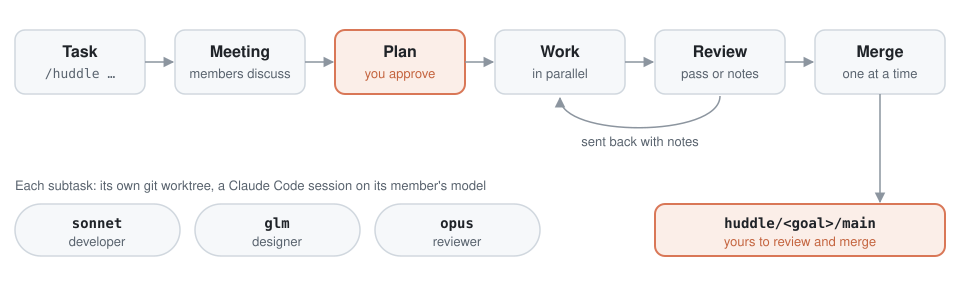

<h1 align="center">cc-huddle</h1>

<p align="center">
  <strong>Multi-agent orchestration for Claude Code.</strong><br>
  A team of Claude Code sessions on your repository. They meet before they plan, work in parallel git worktrees, review and merge each other's work, and ask you when something needs you.
</p>

<p align="center">
  <a href="https://github.com/geezerrrr/cc-huddle/actions/workflows/ci.yml"></a>
  <a href="LICENSE"></a>
  
</p>

<p align="center">
  
</p>

> **Status: early (0.1).** The engine is tested against scripted model streams; long runs with real models are still few. Expect rough edges, and please [report them](https://github.com/geezerrrr/cc-huddle/issues).

## Why another one

Plenty of tools run Claude Code sessions in parallel. In most of them the process is left to someone: you start and assign each session, or a lead model decides how many teammates to spawn, how to split the work and when it is done.

In cc-huddle the process is code. State machines take a goal through a meeting, a plan you approve, parallel work, review and merge; models only do the steps. Every subtask starts in a fresh session, in its own worktree, on the model you chose for that member, and counts as done only once it is reviewed and merged.

|                     | cc-huddle                                                                              | Agent Teams                                                    | Claude Squad, Conductor                  |
| ------------------- | -------------------------------------------------------------------------------------- | -------------------------------------------------------------- | ---------------------------------------- |
| Who splits the work | A meeting of the members; the host writes a plan with owners, dependencies, acceptance | The lead model, from its prompt                                | You, one session at a time               |
| Who approves a plan | You                                                                                    | Teammates' plans are approved automatically unless you step in | You write the tasks                      |
| Isolation           | A git worktree per subtask                                                             | A shared working tree                                          | A worktree per session                   |
| Review              | Another member, against the acceptance criteria; failed work goes back with notes      | A teammate marks its task complete                             | You read each diff                       |
| Merge               | Into the goal's branch, one subtask at a time; conflicts go back to their author       | Nothing to merge: one tree                                     | You merge each branch                    |
| Models              | Any model per member, on any Anthropic-compatible provider                             | Per teammate, on the lead's provider                           | Several agent CLIs (Claude Code, Codex…) |
| Runs as             | A Claude Code plugin, in your session                                                  | Built into Claude Code (experimental)                          | A separate terminal or desktop app       |

For one focused job, a single session or a subagent is cheaper and quicker. cc-huddle is for work with several parts, steps and dependencies.

## What it does

- **Meeting before the plan.** The members you pick discuss the task in turns, read-only. The host writes the plan; you approve it, change it or drop it, and choose which tasks you accept yourself.
- **Parallel work.** Each subtask runs in its own worktree, started once what it waits on is merged and its owner is free. Members can ask each other questions while they work.
- **Review and merge.** A reviewer passes each delivery or sends it back with notes. Merges into `huddle/<goal>/main` go one at a time; a conflict goes back to the member to resolve.
- **Any model per member.** Each member is a Claude Code session with its own model, effort and environment, so one can be Sonnet on your sign-in and another GLM on its own API key.
- **Only you answer.** Permission requests and members' questions go to Claude Code's question dialog and the pane. Your session's model can't answer them.
- **The pane.** `/huddle` shows the meeting as it goes, what each member is doing, the record of a member you follow, tokens used per member, and what waits for you.
- **Pause and resume.** Closing the session pauses its goal; `/huddle resume` goes on where it stopped.
- **Git stays yours.** It works only on `huddle/*` branches, never pushes and never checks anything out in your working tree.

## Install

Requirements: Claude Code 2.1.322 or later, Node.js 22.15 or later with npm on your `PATH`, and git. The plugin's MCP server installs its own dependencies with npm on its first start.

From GitHub, in a terminal:

```sh
claude plugin install cc-huddle --marketplace geezerrrr/cc-huddle
```

Or inside Claude Code:

```
/plugin marketplace add geezerrrr/cc-huddle
/plugin install cc-huddle@geezerrrr
```

From a local clone:

```sh
git clone https://github.com/geezerrrr/cc-huddle.git
claude plugin marketplace add ./cc-huddle
claude plugin install cc-huddle@geezerrrr
```

To try it without installing, start a session with the plugin loaded from the clone: `claude --plugin-dir ./cc-huddle/plugin`. The built plugin is committed, so there is nothing to build.

Restart Claude Code after installing. To update, `claude plugin update cc-huddle@geezerrrr`. To uninstall, `claude plugin uninstall cc-huddle@geezerrrr`: this removes the plugin's data folder with its worktrees and any work not yet delivered; work already merged stays on the `huddle/*` branches, and `--keep-data` keeps the folder.

## Set up a team

A team is Markdown files: roles, and members who each take a role. Put them in `~/.claude/huddle/` for all your repositories, or in a repository's `.claude/huddle/`. One role and two members is enough to start:

```sh
mkdir -p ~/.claude/huddle/roles ~/.claude/huddle/members
printf -- '---\ntitle: Developer\n---\n\nWrite the code for your subtask and its tests.\n' > ~/.claude/huddle/roles/developer.md
printf -- '---\nrole: developer\nmodel: sonnet\n---\n' > ~/.claude/huddle/members/sonnet.md
printf -- '---\nrole: developer\nmodel: opus\n---\n' > ~/.claude/huddle/members/opus.md
```

A member without `env` runs on your own Claude Code sign-in. A member on another provider names its endpoint and key:

```markdown
---
role: designer
model: glm-5.3-flashx
env:
  ANTHROPIC_BASE_URL: https://open.bigmodel.cn/api/anthropic
  ANTHROPIC_AUTH_TOKEN: ${GLM_API_KEY}
---
```

`${VAR}` is filled in from your environment, so keys stay out of the files. Effort, Claude Code settings for the whole team, review and meeting size: [docs/configuration.md](docs/configuration.md).

## Use it

Start Claude Code in a repository and hand the team a task:

```
/huddle build a two-player dice game, opus on the rules, sonnet on the UI
```

Your session proposes a meeting (who attends, what each brings), or one member for a job that needs no planning, and asks you to start. The team then works in the background; your session stays free.

| You type                               | What happens                                                                   |
| -------------------------------------- | ------------------------------------------------------------------------------ |
| `/huddle <task>`                       | Hands the team a task                                                          |
| `/huddle`                              | Opens the pane: the meeting, the team, what needs you                          |
| `/huddle status`                       | Prints where the session's goal stands                                         |
| `/huddle pause`, `/huddle resume`      | Pauses the session's goal; resumes it, or takes up another of the repository's |
| `@sonnet put the scoreboard top right` | Passes a member a message, in their session                                    |

You can also ask your session in words ("have opus do the scoreboard"). A session runs one goal; for more goals at once, run more sessions. The band above the prompt keeps count: `cc-huddle · meeting · 3 working · 1 needs you`.

## How it works

<p align="center">
  
</p>

1. **Meeting.** The members discuss the task in turns, read-only in the repository. The host writes the plan.
2. **Plan.** You approve it, change it or drop it.
3. **Work.** Each subtask starts in its own worktree once what it waits on is merged and its owner is free.
4. **Review.** The meeting's host, or another member, judges each delivery against its acceptance criteria. A failed review sends it back with notes.
5. **Merge.** Passed work merges into the goal's branch, one subtask at a time. A task is done when its last subtask merges, or when you accept it if you chose to.

<table>
  <tr>
    <td width="50%"></td>
    <td width="50%"></td>
  </tr>
  <tr>
    <td align="center">The meeting</td>
    <td align="center">The team at work</td>
  </tr>
</table>

The full design, state machines included, is [docs/design.md](docs/design.md).

## Cost and permissions

- **Tokens.** Each member's turn is a Claude Code process on that member's provider, several at once. The pane shows the tokens each member has used.
- **Permissions.** Members work under your Claude Code settings and your session's permission mode, plus the team's `settings.json`. Meetings, reviews and answers to teammates are read-only. Anything Claude Code would ask about is asked of you. Details: [What runs, and what it may do](docs/configuration.md#what-runs-and-what-it-may-do).
- **Data.** Each goal's state, records and worktrees are in the plugin's data folder, outside your repository.

## Contributing

See [CONTRIBUTING.md](CONTRIBUTING.md). Security issues: [SECURITY.md](SECURITY.md).

cc-huddle's engine comes from [Crewloft](https://playcrewloft.com), a game in which it runs a studio of AI staff.

## License

[MIT](LICENSE)
