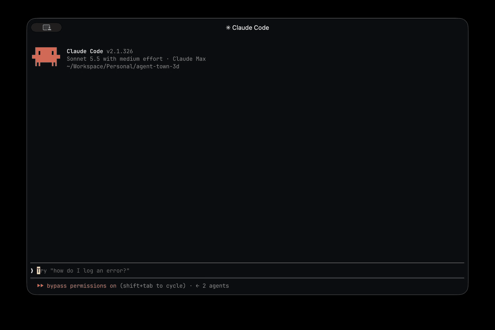

<h1 align="center">cc-huddle</h1>

<p align="center">
  <strong>为 Claude Code 打造的多 Agent 协作插件。</strong>
</p>

<p align="center">
  <a href="README.md">English</a> · <strong>简体中文</strong>
</p>

<p align="center">
  <a href="https://github.com/geezerrrr/cc-huddle/actions/workflows/ci.yml"></a>
  <a href="LICENSE"></a>
  
</p>

cc-huddle 是一个 Claude Code 插件，让一支 agent 团队在你的仓库里协作。它通过 Agent SDK 驱动每个成员，每个成员都是原生的 Claude Code 会话：工具调用、权限请求和结果都以事件的形式交给 cc-huddle，不靠读屏幕。成员们先开会定计划，再并行开发、互相评审。你只管批准计划、验收结果，团队在后台干活，不占用你的会话。

<p align="center">
  
</p>

> **当前是早期版本（0.1）。** 只做过脚本模拟测试和少量真实运行，难免有问题，欢迎[反馈](https://github.com/geezerrrr/cc-huddle/issues)。

## 特性

- **原生 Claude Code。** 成员通过 Agent SDK 运行，不是开在终端窗格里。每次工具调用、权限请求和结果都是事件；权限确认照常找你，成员的会话随时能接着做。
- **流程由代码控制。** 哪个任务该开工、哪个要等前置任务、怎样才算完成，都由状态机判断，不靠模型自觉。模型只负责干活。
- **开一次会定计划。** 每个成员先各自给出判断，互相看不到；然后举手发言，由主持人点名。主持人写出计划：拆成哪些任务、谁负责、谁依赖谁、怎么验收。你可以批准、修改或放弃。
- **并行、互不干扰。** 每个子任务有自己的会话和 git worktree，等它依赖的工作合并后再开工。
- **按验收标准评审。** 每份交付由另一名成员只对照验收标准评审。不通过就带着意见退回原来的会话。成员运行出错时会话保留，你可以让它在原处接着做。
- **断了能续。** 进度保存在文件里，不依赖会话的上下文。关掉终端也没关系，`/huddle resume` 接着上次继续。
- **上下文小。** 每个子任务的会话只装自己那部分，不会随整个活一起膨胀。[一次实测](docs/trial.md)在同一个任务上对比了团队和单个会话。
- **模型随便选，框架只用一套。** 每个成员可以用不同的模型，只要服务商兼容 Anthropic API；但所有成员都运行在 Claude Code 里，沿用你的设置、权限和 CLAUDE.md。

## 安装

在 Claude Code 里输入：

```
/plugin marketplace add geezerrrr/cc-huddle
/plugin install cc-huddle@geezerrrr
```

装完重启 Claude Code。运行环境：Claude Code 2.1.332 及以上、Node.js 22.15 及以上（需要能找到 npm）、git。第一次启动时会自动用 npm 安装依赖。

<details>
<summary>其他安装方式，以及更新和卸载</summary>

在终端里安装：

```sh
claude plugin install cc-huddle --marketplace geezerrrr/cc-huddle
```

从本地克隆安装：

```sh
git clone https://github.com/geezerrrr/cc-huddle.git
claude plugin marketplace add ./cc-huddle
claude plugin install cc-huddle@geezerrrr
```

不想安装，也可以直接加载克隆下来的插件试用：`claude --plugin-dir ./cc-huddle/plugin`。仓库里已包含构建产物，无需自己构建。

更新：`claude plugin update cc-huddle@geezerrrr`。卸载：`claude plugin uninstall cc-huddle@geezerrrr`。卸载会删除插件的数据目录，其中的 worktree 和还没交付的工作会一起删掉；已经合并的工作仍保留在 `huddle/*` 分支上。想保留数据目录，加上 `--keep-data`。

</details>

## 组建团队

团队成员写在 `team.yaml` 里。第一次启动时，cc-huddle 会生成一份带注释的示例 `~/.claude/huddle/team.yaml`，照着填上你的成员即可。某个仓库想用不同的团队，可以在仓库的 `.claude/huddle/` 下另放一份。

```yaml
# ~/.claude/huddle/team.yaml
members:
  opus:
    role: developer
    model: opus
  sonnet:
    role: developer
    model: sonnet
  deepseek:
    role: developer
    env:
      ANTHROPIC_BASE_URL: https://api.deepseek.com/anthropic
      ANTHROPIC_AUTH_TOKEN: ${DEEPSEEK_API_KEY}
      ANTHROPIC_MODEL: deepseek-flash
```

不写 `env` 的成员使用你当前的 Claude Code 账号；要接其他服务商，就在 `env` 里填它的环境变量。`${VAR}` 会从系统环境变量中读取，密钥不用写进文件。`role` 只是个名字；想给这个角色定些规矩，可以写到 `roles/<role>.md` 里。推理强度（effort）、权限以及各服务商的完整配置，见 [docs/configuration.md](docs/configuration.md)。

## 使用

在仓库里打开 Claude Code，把任务交给团队：

```
/huddle add Stripe subscriptions: checkout, webhooks and a billing page
```

1. **开始。** cc-huddle 会建议这个任务交给整个团队还是某一个成员，并给出理由，由你决定。只选一个成员时不开会，直接开工。
2. **定计划。** 会议在后台进行，可以在面板里实时旁观。计划出来后会弹出对话框让你确认：可以批准、提修改意见或直接放弃，还可以勾选哪些任务完成后要你亲自验收。
3. **开发。** 成员并行开发；有前置依赖的子任务，等依赖的工作合并后再开始。成员之间会互相提问，只有你才能回答的问题才会来找你。
4. **验收。** 你勾选的任务完成后，会告诉你做了什么、怎么检查。
5. **合并。** 所有工作先汇总到 `huddle/<goal>/main` 分支。全部完成后，会询问你是否合并回当初的分支，合并后可以顺手清理 worktree 和临时分支。cc-huddle 不会执行 push。

| 命令                              | 作用                                               |
| --------------------------------- | -------------------------------------------------- |
| `/huddle <task>`                  | 给团队布置一个新任务                               |
| `/huddle`                         | 打开面板，查看会议、团队状态和待你处理的事项       |
| `/huddle status`                  | 查看当前任务的进展                                 |
| `/huddle pause`、`/huddle resume` | 暂停当前任务；恢复它，或接手仓库里其他未完成的任务 |
| `/huddle review on\|off`          | 开启或关闭交付评审                                 |
| `/huddle meeting <size>`          | 设置会议规模：`small`、`discussion` 或 `large`     |
| `/huddle parallel on\|off`        | 是否允许一名成员同时做多项工作                     |

也可以直接用大白话跟会话说。一个会话同一时间只跑一个任务；想同时跑多个，就多开几个会话。

## 成本与权限

- **Token。** 每个成员每次工作都会启动一个独立的 Claude Code 进程，走该成员自己的服务商，多个进程会同时运行。每个成员消耗了多少 token，面板里都能看到。换用别家模型的成员，做同样的活可能多用很多 token、花更长时间；这取决于模型，与调度无关。
- **权限。** 成员沿用你的 Claude Code 设置和当前会话的权限模式，团队的 `settings.json` 可以再追加规则。开会、评审、回答队友提问时都是只读的。详见 [What runs, and what it may do](docs/configuration.md#what-runs-and-what-it-may-do)。
- **数据。** 任务的状态、记录和 worktree 都放在插件的数据目录里，不会放进你的仓库。

## 设计说明

**什么情况不适合用。** 目标单一的小任务，直接用一个会话或子 agent 更快、更省。cc-huddle 适合由多个部分组成、相互有依赖的工作。

**为什么用 Agent SDK。** 带团队也可以这样做：在终端窗格里开每个命令行，往里敲字，再读屏幕判断它是就绪、在忙还是做完了。这种猜测很容易出错；权限确认会被跳过，因为没有东西能回答它；成员挂了就从头再来。通过 Agent SDK，cc-huddle 拿到的每一步都是事件，权限请求交给你，成员停下后在它自己的会话里接着做。

**为什么只用一套框架。** 这是我们从跨工具评审的经验里得出的看法，没有做过量化测量。Claude Code、Codex、Gemini CLI 这些框架各有各的系统提示词和 agent loop，习惯也就各不相同。让一个框架去评审另一个框架写的代码，除了能挑出真问题，也会把“习惯不同”当成问题，有些修改建议改了反而更糟。人工做跨工具评审时，这些可以筛掉：把意见交回原来的工具判断，只采纳它认可的。但团队自动运转时没有人筛，每条意见都会变成返工。所以 cc-huddle 的做法是：模型可以不同，框架保持一致；评审只看验收标准，因为只让模型“找问题”，它永远找得出来。如果你有不同看法，欢迎到 [issues](https://github.com/geezerrrr/cc-huddle/issues) 讨论。

完整的设计文档（含状态机）见 [docs/design.md](docs/design.md)。

## 参与贡献

请看 [CONTRIBUTING.md](CONTRIBUTING.md)。安全问题请看 [SECURITY.md](SECURITY.md)。

cc-huddle 的引擎来自游戏 [Crewloft](https://playcrewloft.com)，在游戏里它负责运转一间由 AI 员工组成的工作室。

## 许可

[MIT](LICENSE)
