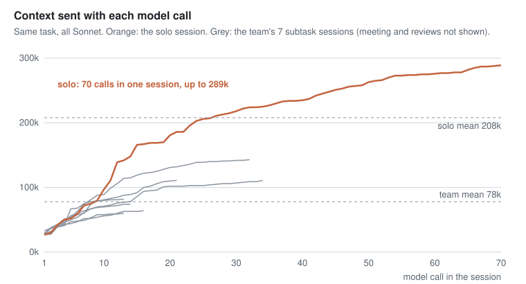

# A trial: one session against a team

One task done twice, all on Sonnet: building a playable mini-game into a 3D game, once by a single session and once by a team of five.

|                     | One session | A team of five                       |
| ------------------- | ----------- | ------------------------------------ |
| Time                | 25m 33s     | 26m 44s, the meeting 3m 12s of it    |
| Tokens              | 14.87M      | 12.79M: meeting 0.69M, reviews 0.79M |
| Code                | 1,703 lines | 3,260 lines, 880 of them tests       |
| Model calls at work | 70          | 143                                  |

  

The team made twice as many calls and used fewer tokens. Each call sends the whole session so far: the single session grew to 289k, while each subtask's session held only its own part, 78k a call on average against 208k. Both versions were playable, and much alike.

We have run only a few comparisons like this, and a model's output varies from run to run, so take it as a sample, not a benchmark. Many more cost more than we can spend for now.
